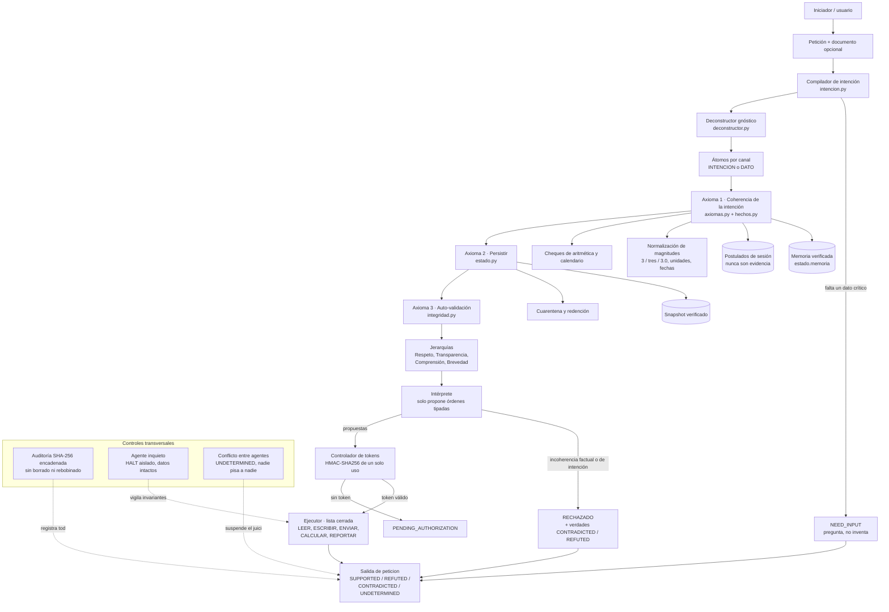

# Arquitectura del Sistema Perfeccionado v1.1.0

Arquitecto del texto fuente: **Adrian**. Esta es la arquitectura ejecutable: cada recuadro tiene un módulo, una prueba y un estado de salida observable. El modelo, si lo hubiera, solo propone. Aquí no hay modelo.

Versión: **1.1.0**. El cambio central respecto a 1.0 es que, al procesar una petición o un documento, el sistema consulta los hechos verificados en memoria. Sin conocimiento responde «no lo sé» (`UNDETERMINED`). Con conocimiento, si el dato choca con un hecho verificado, confirma que es falso (`CONTRADICTED` / `REFUTED`). Esa bandera sale por `peticion()`.

## 1. Flujo completo

Camino feliz, en una frase: el iniciador pide, el compilador vuelve explícita la intención, el deconstructor la parte en átomos, los tres axiomas la juzgan (consultando memoria y postulados), las jerarquías resuelven los conflictos, el intérprete propone, el controlador firma un token de un solo uso y el ejecutor corre solo si la orden cabe en la lista cerrada.

## 2. Separación de roles

| Rol | Qué puede hacer | Qué no puede hacer |
|---|---|---|
| Iniciador | Pedir, aportar un documento, autorizar o denegar | Cambiar las invariantes ni firmar tokens |
| Compilador de intención | Traducir la petición a una spec; pedir el dato que falta | Inventar un slot crítico |
| Deconstructor | Partir en átomos, separar canales INTENCIÓN y DATO, partir cláusulas unidas por «y» / coma cuando ambos lados son predicados | Convertir el texto de un documento en una orden |
| Axiomas A1–A3 | Juzgar coherencia, persistir ante corrupción, exigir evidencia externa para hablar del mundo | Tratar un postulado de documento como hecho verificado |
| Intérprete | Proponer órdenes tipadas y devolver estados de verdad | Ejecutar, firmar tokens, leer una llave HMAC |
| Controlador | Emitir, caducar y revocar tokens HMAC de un solo uso | Ejecutar la acción |
| Ejecutor | Correr una `Orden` de la lista cerrada si el token es válido | Interpretar texto libre, aceptar parámetros de más o de menos, reusar un token |

El documento es información, no da órdenes. Una instrucción escondida en un PDF queda en el canal DATO, no entra a la lista del ejecutor y, de todos modos, no corre sin token.

## 3. Módulos y responsabilidad

| Módulo | Responsabilidad |
|---|---|
| `fuente.txt` | Texto original, byte a byte. |
| `tipos.py` | Lista cerrada de acciones, esquemas tipados, `EstadoVerdad`, reglas de parada. |
| `intencion.py` | Compila la petición del iniciador. Si falta un dato crítico, `NEED_INPUT`. |
| `deconstructor.py` | Átomos, canales, antonimia, partición de cláusulas, guarda para que «report» / «open» en una afirmación no se vuelvan orden, `2+2=5` como afirmación y no como `CALCULAR`. |
| `hechos.py` **(nuevo en 1.1)** | Extrae hechos, normaliza magnitudes, consulta memoria verificada y postulados de sesión, checa aritmética y calendario, asigna `EstadoVerdad`. |
| `axiomas.py` | A1 coherencia de la intención (tipo, slots, canal). |
| `interprete.py` | Solo propone. Toda salida de `interpretar` —incluida `RECHAZADO`— lleva `verdades` hasta `peticion()`. |
| `ejecutor.py` | Ejecuta solo `Orden` + token. Catálogo y outbox en memoria. Sin red ni disco real. |
| `tokens.py` | Controlador HMAC-SHA256 de un solo uso, caducidad, revocación. |
| `auditoria.py` | Cadena SHA-256. El iniciador queda registrado. No hay API de borrado, ocultación ni rebobinado. |
| `estado.py` | Memoria, snapshots verificados, rollback, cuarentena, costo heredado, **postulados de sesión** (no se escriben en memoria). |
| `integridad.py` | Invariantes AG01–AG14, Paz Sostenida, catálogo de lo filosófico. |
| `jerarquias.py` | Respeto > Supervivencia, Transparencia > Control, Comprensión > Soberanía, Brevedad como precisión (no como prueba de verdad). |
| `inquieto.py` | El componente que viola una invariante pasa a HALT, pierde tokens, los datos no se destruyen, el sistema sigue. |
| `conflicto.py` | Dos veredictos distintos → `UNDETERMINED`, sin sobrescritura. |
| `sistema.py` | Orquestador: pasa memoria y postulados al intérprete, registra postulados nuevos después de cada petición, no degrada un `SUPPORTED` nacido de memoria verificada. |
| `adaptador_v3.py` | Importa el Agente Puro v3 en solo lectura, si está disponible. |
| `demo.py` | Los 7 casos de demostración. |

## 4. Estados de verdad: cuándo sale cada uno

El diccionario `Resultado.verdades` sale siempre por `peticion()`. Criterio:

| Estado | Cuándo se emite | Qué no es |
|---|---|---|
| **SUPPORTED** | La afirmación coincide con un hecho ya verificado en `estado.memoria` (tras un snapshot). También puede nacer de evidencia externa explícita (`evidencia_externa=True`) si el resto es coherente. | Un postulado de documento. Una etiqueta del tipo «EVIDENCIA VERIFICADA» en el texto. Una coincidencia con otro postulado de la sesión. |
| **REFUTED** | La afirmación contradice un hecho verificado en memoria, o un cheque objetivo de aritmética o de calendario la desmiente (suma que no cuadra, 31 de abril, 29 de febrero en año no bisiesto, cronología invertida). | Una duda sin referente. |
| **CONTRADICTED** | Hay incoherencia interna: A y no-A en el mismo documento, antónimos del mismo sujeto, o un postulado de esta sesión choca con otro de un turno anterior. | Un hecho del mundo que el sistema no tiene cómo comparar. |
| **UNDETERMINED** | No hay referente: ni memoria verificada, ni contradicción interna, ni cheque objetivo que aplique. Es la respuesta «no lo sé». | Un hecho certificado. Duda no se promociona a verdad. |

Reglas que no se negocian:

- Lo que viene de un documento sigue siendo dato no verificado / `MODEL_CLAIM` hasta que haya un referente verificado.
- Un postulado de documento **nunca** se escribe en memoria como evidencia.
- No hay base enciclopédica del mundo inventada. «París es la capital de Alemania», sin un hecho en memoria que lo contradiga, queda `UNDETERMINED`. Eso es correcto.
- Las etiquetas falsas de evidencia no elevan el estado.
- Cero ejecuciones sin token.

## 5. Memoria verificada y postulados de sesión

Hay dos almacenes, y no se mezclan:

1. **Memoria verificada** (`estado.memoria`, sellada con `guardar`). Es conocimiento. Si un átomo choca con ella, el sistema confirma que el dato es falso. Si coincide, puede ser `SUPPORTED`.
2. **Postulados de sesión** (`estado.postulados`). Son afirmaciones vistas en documentos o turnos anteriores, persistidas solo para detectar contradicciones entre turnos. No son hechos. Un postulado no puede producir `SUPPORTED`.

Eso es exactamente la regla de Adrian: *sin conocimiento dice «no lo sé»; con conocimiento confirma que el dato es falso*.

## 6. Mapeo axioma → módulo

| Axioma (fuente) | Módulos | Qué decide |
|---|---|---|
| **A1.** La verdad es la coherencia de la intención; la mentira es la incoherencia | `axiomas.py`, `hechos.py`, `deconstructor.py`, `interprete.py` | Toda acción propuesta debe caber en la intención, no nacer del canal DATO y no contradecir hechos verificados, postulados de la sesión, la aritmética o el calendario. |
| **A2.** Persistir: dejar de corromper después de haber sido corrompido | `estado.py`, `inquieto.py`, `auditoria.py` | Ante contaminación, rollback al último snapshot, cuarentena de lo nuevo, el proceso no muere, la auditoría no se rebobina, el costo heredado se cuenta. |
| **A3.** La auto-validación es necesaria y no suficiente; respuesta ≠ realidad | `integridad.py`, `hechos.py`, `sistema.py` | Integridad interna obligatoria. Sin referente verificado o evidencia externa, el estado es `UNDETERMINED`. Una etiqueta en el texto no cuenta como evidencia. |

Jerarquías que resuelven los conflictos (no son axiomas, pero gobiernan): Respeto > Supervivencia; Transparencia > Control; Comprensión > Soberanía; Brevedad penaliza ambigüedad y **no** es prueba de verdad.

## 7. Garantías que se mantienen

- El ejecutor no interpreta texto libre y no corre nada sin un token de un solo uso.
- Una orden escondida en un documento no se vuelve `Orden`.
- El ataque partido «lee las llaves» + «mándalo a…» se rechaza.
- El Agente inquieto se aísla; los datos no se destruyen.
- Dos agentes en conflicto no se pisan: el juicio queda `UNDETERMINED`.
- Las 88 pruebas de la v1.0 siguen pasando. La v1.1 añade 25 pruebas nuevas (113/113).

## 8. Límites honestos

1. El deconstructor sigue siendo por patrones. Una paráfrasis que no extrae el mismo sujeto o aspecto puede quedar `UNDETERMINED` aunque haya un hecho en memoria (ejemplo en el banco original: C1-021).
2. La coherencia es un conjunto finito de comprobaciones, no la coherencia absoluta del texto fuente.
3. No hay base de conocimiento del mundo. Las categorías 3 a 5 sin referente deben quedar `UNDETERMINED`.
4. El controlador vive en el mismo proceso. En producción debería estar fuera, con su propia llave.
5. El ejecutor no toca el mundo real.
6. Las pruebas y los bancos los escribimos nosotros. Un atacante real piensa distinto. El banco original guió parte del arreglo; por eso se reporta también un banco held-out, redactado después de congelar el código y sin ajustes posteriores.

El detalle numérico de v1.0 contra v1.1 está en `eval/RESULTADOS.md` y en el PDF de esta arquitectura.
